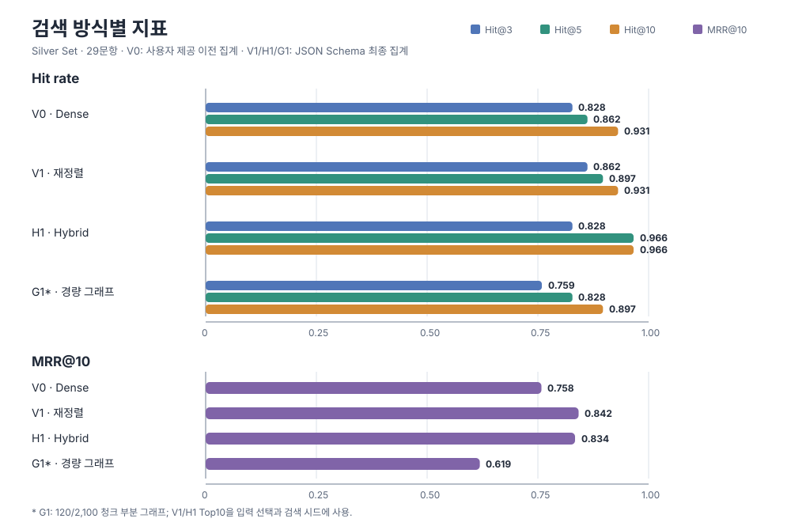

<!--
책임: 기존 RAG 검색 방식과 대안 검색 방식의 근거 회수 결과를 설명한다.
구현할 기능: 질문, 평가 설계, G1 수정 경위, 정량 결과와 한계를 하나의 흐름으로 제공한다.
완료 기준: 공개된 근거만 사용하고 검색 성과와 최종 답변 정확도를 구분한다.
-->

# 다른 검색 방식을 쓰면 정답 근거를 더 잘 찾을까?

## 1. 질문과 짧은 답

**실험 질문:** “내 기존 RAG 말고 다른 서치 방법을 선택하면 정말 정답을 찾을 확률이 바로 올라갈까?”

**짧은 답:** 29문항 Silver Set에서 Hybrid(H1)는 기존 검색(V1)보다 Hit@5와 Hit@10이 높았지만 Hit@3과 MRR@10은 낮았다. 검색 방식을 바꾸면 모든 순위 구간에서 정답 근거를 더 잘 찾는다고 볼 수 없다. 이 실험은 검색된 근거 청크를 평가했으며, 최종 생성 답변의 정답률을 측정하지 않았다.

| 지표 | 기존 검색 V1 | Hybrid H1 | H1 − V1 |
|---|---:|---:|---:|
| Hit@3 | 0.862 (25/29) | 0.828 (24/29) | 1문항 감소 (약 −3.45%p) |
| Hit@5 | 0.897 (26/29) | 0.966 (28/29) | 2문항 증가 (약 +6.90%p) |
| Hit@10 | 0.931 (27/29) | 0.966 (28/29) | 1문항 증가 (약 +3.45%p) |
| MRR@10 | 0.842 | 0.834 | −0.008 |
| nDCG@10 | 집계 없음 | 집계 없음 | 비교 불가 |

Hit@k의 문항 수는 기록된 비율과 29문항을 기준으로 환산했으며, 퍼센트포인트 차이는 이 문항 수로 계산했다. 지표의 세 자리 값은 기존 집계의 반올림값이다. 이 표는 잠정 Silver Set의 기술적 비교이며, 통계적 유의성이나 end-to-end 답변 정확도의 향상을 입증하지 않는다.

## 2. 실험 설계와 평가 신뢰도

### 비교 범위

| 표기 | 검색 방식 | 핵심 동작 |
|---|---|---|
| V0 | Dense | 임베딩 코사인 순위 |
| V1 | 기존 검색 | Dense 후보를 현재 재정렬 방식으로 정렬; 이 비교의 기준선 |
| H1 | Hybrid | Dense와 BM25 순위를 RRF(`k=60`)로 결합 |
| G1 | Ollama 경량 GraphRAG | 선택된 청크의 일부로 구축한 그래프를 검색에 사용 |

V0/V1/H1은 같은 청크와 임베딩 조건으로 비교했다. 사용한 문서 범위는 5종, 질문은 29문항이다. 저장소의 검색 임베딩 구현은 `google/embeddinggemma-2`, 768차원이다. 과거 실행 장비와 전체 run manifest는 공개 집계에 없어 이 보고서에서는 확인된 실행 조건 이상을 주장하지 않는다.

### 왜 Golden Set이 아니라 Silver Set인가

29문항에는 답변 가능성 표시와 정답 근거 청크 매핑이 있지만, 모든 문항의 정답 근거가 빠짐없이 매핑됐는지 최종 사람 검수로 확정되지 않았다. 기존 실험 기록도 이를 정답 검수 전의 임시 비교 세트로 표시한다. 따라서 이 보고서에서는 Golden Set이라고 부르지 않는다. Silver라는 구분의 이유는 문항 수 자체가 아니라 정답 라벨과 근거 매핑의 검수 상태다.

이 상태에서는 Hit@k가 해당 잠정 매핑을 얼마나 회수했는지를 보여준다. 매핑에 누락된 정답 근거가 있는지 외부에서 확인할 수 없으므로, 결과를 검수 완료된 정답률로 읽어서는 안 된다.

기존 기록에는 검수자와 구체적인 검수 기준이 따로 기재되어 있지 않다. 따라서 여기서는 정답 근거의 최종 검수가 끝나지 않았다는 사실만 보고하며, 누가 어떤 절차로 각 문항을 검수했는지는 추정하지 않는다.

### G1은 별도 범위의 파일럿

G1은 전체 2,100개 청크 중 120개에만 그래프를 구축했다. 청크 선택과 검색 시드에 기존 V1/H1 Top10을 사용했으며, JSON Schema 최종 실행에서도 V1/H1 검색 기록을 재사용하고 G1만 갱신했다. 따라서 G1은 V0/V1/H1과 같은 조건의 독립 비교군이 아니며, 결과를 전체 코퍼스 GraphRAG 성능으로 일반화할 수 없다. 이 결과는 Ollama 경량 G1에 해당한다. Microsoft GraphRAG Local/Global 래퍼 결과와는 별개다.

```mermaid
flowchart LR
    D[5종 문서 출처] --> C[공통 청크·임베딩]
    Q[29문항 Silver Set] --> V0[V0 Dense]
    Q --> V1[V1 기존 검색]
    Q --> H1[H1 Hybrid]
    C --> V0
    C --> V1
    C --> H1
    V0 --> E[Hit@k · MRR@10]
    V1 --> E
    H1 --> E
    V1 --> P[V1/H1 Top10으로 G1 입력·시드 선택]
    H1 --> P
    C --> P
    P --> G[120개 부분 그래프 · Ollama G1]
    Q --> G
    G --> E
```

## 3. 전체 정량 결과

Hit@k는 평가 문항 중 상위 k개 검색 결과에서 매핑된 정답 근거를 하나 이상 찾은 비율이다. MRR@10은 첫 정답 근거 순위의 역수 평균이며, 상위 10개에서 찾지 못한 문항은 0으로 계산한다. 수치는 29문항 기준이다.

| 방식 | Hit@3 | Hit@5 | Hit@10 | MRR@10 | nDCG@10 | 수치 출처 |
|---|---:|---:|---:|---:|---:|---|
| Dense (V0) | 0.828 | 0.862 | 0.931 | 0.758 | 0.799 | 사용자가 제공한 이전 비교 집계 |
| 기존 검색 (V1) | 0.862 | 0.897 | 0.931 | 0.842 | 집계 없음 | JSON Schema 최종 집계; 기존 V1 기록 재사용 |
| Hybrid (H1) | 0.828 | 0.966 | 0.966 | 0.834 | 집계 없음 | JSON Schema 최종 집계; 기존 H1 기록 재사용 |
| 경량 GraphRAG (G1)* | 0.759 | 0.828 | 0.897 | 0.619 | 집계 없음 | JSON Schema 최종 집계 |

\* G1은 120개 청크의 부분 그래프와 V1/H1 Top10을 활용한 파일럿으로, 다른 방식과 독립적인 동일 조건 비교는 아니다.



V0 값은 확인 가능한 최종 G1 집계 파일에 없고 사용자가 제공한 이전 비교 집계에서 왔으므로 출처를 별도로 표시했다. nDCG@10은 V0 값만 확인된다. V1/H1/G1은 집계가 없어 공란으로 두었으며 다른 지표로 계산하지 않았다.

H1은 V1보다 정답 근거를 찾은 문항이 Hit@5에서 2개, Hit@10에서 1개 더 많았다. Hit@3에서는 1개 적었고 MRR@10도 0.008 낮았다. 상위 5~10개 후보에서 근거를 더 자주 회수했지만, 첫 결과 순위까지 일관되게 개선한 것은 아니다.

## 4. G1 추출 문제, 수정, 결과

### 문제와 원인

G1 그래프 검색이 청크를 활용하려면 각 입력 청크에서 개체·관계를 추출해 그 청크에 연결해야 한다. 최초 실행은 Ollama에 `format="json"`을 요청했지만 필수 필드와 자료형을 고정하는 Schema를 전달하지 않았다. 120개 중 63개 추출 행이 기대한 객체·필드 구조를 만족하지 못해 오류 처리됐고, 해당 행은 유효한 개체·관계를 그래프에 제공하지 못했다. 청크 ID 자체가 사라진 문제가 아니라 청크 내용의 그래프 요소를 안정적으로 추출하지 못한 문제였다.

### 변경과 추출 성공 수

Ollama 요청에 JSON Schema를 전달해 출력 구조를 제한하고, 실패한 청크만 재시도했다. 기존 성공 57건은 그대로 보존했다. 개체의 청크 본문 일치 검사와 관계 끝점 검증은 이전 G1 코드에도 있었으므로, 이번 변경에서 새로 추가된 기능으로 보지 않는다.

| 상태 | 추출 행 | 오류 없음 | 코드 검증을 통과한 개체가 있는 청크 행 | 오류 없이 끝났지만 개체가 없는 청크 행 | 오류 |
|---|---:|---:|---:|---:|---:|
| 수정 전 `format="json"` | 120 | 57 | 34 (28.3%) | 23 | 63 |
| JSON Schema 수정 후 | 120 | 118 (98.3%) | 95 (79.2%) | 23 | 2 |

여기서 “코드 검증을 통과한 개체”는 예상한 JSON 필드·자료형·길이 검사를 통과하고, 개체명이 입력 청크 본문에 실제로 포함되는지 확인된 추출 결과를 뜻한다. 사람의 의미 검수나 사실성 판정을 뜻하지 않는다. 이 개체 포함 청크 행은 34개에서 95개로 늘었고, 개체가 없는 성공 행 23개는 전후 모두 남았다.

JSON Schema 재시도는 최초 실패 63개만 대상으로 해 61개를 오류 없이 처리했고 2개는 남았다. 따라서 `118/120 오류 없음`을 `118개 청크 모두 그래프가 인식됨`으로 읽으면 안 된다.

남은 2건은 Schema의 원시 문자열 길이 검증은 통과했지만, 애플리케이션이 공백을 제거한 뒤 최소 길이를 다시 검사해 한 글자 값으로 판정한 오류다. 이 두 공백 처리 오류는 수정하지 않았다.

### 수정 전후 G1 검색 집계

| G1 실행 | Hit@3 | Hit@5 | Hit@10 | MRR@10 |
|---|---:|---:|---:|---:|
| 수정 전 `format="json"` | 0.276 | 0.517 | 0.966 | 0.300 |
| JSON Schema 적용 후 | 0.759 | 0.828 | 0.897 | 0.619 |

수정 후 오류 없이 처리된 행은 57개에서 118개로, 코드 검증을 통과한 개체가 있는 청크 행은 34개에서 95개로 늘었다. 검색 집계에서는 Hit@3/5와 MRR@10이 높아졌고 Hit@10은 낮아졌다. 추출 복구와 검색 지표는 별도 결과다. 수치 변화 전체가 Schema 하나 때문에 발생했다고 단정할 수 없으며, 특히 Hit@10이 낮아진 원인은 확인되지 않았다. 최종 집계는 V1/H1 기록을 다시 계산하지 않고 재사용했으며 G1 검색·답변 기록만 갱신했다.

G1 최종 실행은 V1/H1 Top10 합집합 밖의 새 정답 청크를 추가하지 못했다. 기존 G1에서 잡았던 정답 청크 쌍 2건도 최종 실행에서는 사라졌다. 따라서 그래프 추출 성공률이 높아진 사실을 독립 검색 성능 향상으로 해석하지 않는다.

## 5. 판단과 한계

1. **핵심 질문의 답:** 다른 검색 방식을 고르면 정답 근거 회수율이 바로 전반적으로 오르는 것은 아니다. 이 29문항 비교에서 H1은 Hit@5/10을 높였고, V1은 Hit@3/MRR@10에서 앞섰다.
2. **H1:** 상위 5~10개에서 근거를 더 잘 회수한 후보로 유지하되, Golden 수준으로 검수된 평가 세트에서 추가 검증한다.
3. **V1:** 상위 순위 성능의 기준선으로 유지한다.
4. **G1:** 부분 그래프, 기준선 Top10 재사용, 추가 정답 근거 부재와 남은 추출 실패 2건 때문에 확대 적용을 보류한다.

이 실험의 측정 대상은 검색 결과에 정답 근거 청크가 포함됐는지다. 집계 코드의 `answer_errors`는 생성 오류를 세며, 답변 내용의 사실성이나 답변과 근거의 의미상 일치를 평가하지 않는다. 따라서 검색 지표의 변화만으로 최종 답변의 정답 확률이 높아졌다고 결론 내릴 수 없다. 질문 원문·gold 매핑·전체 검색 추적과 원시 모델 로그는 공개하지 않으므로, 공개 문서만으로 독립 재계산할 수도 없다. 표본이 29개이고 Silver Set이므로 결과는 잠정 비교로 해석한다.

## 참고 자료

실험 실행 방법은 [`README.md`](./README.md), 전체 사례 요약은 [`RESULTS.md`](./RESULTS.md)를 참고한다. 아래 링크는 데이터 출처이며, 데이터 본문이나 원본 미디어를 이 저장소에 포함하지 않는다.

- [FinanceBench — PatronusAI](https://huggingface.co/datasets/PatronusAI/financebench)
- [ChartQA — vis-nlp](https://github.com/vis-nlp/ChartQA)
- [AMI Meeting Corpus](https://groups.inf.ed.ac.uk/ami/download/)
- [YouCook2 공식 배포 안내](https://youcook2.eecs.umich.edu/download)
- [Enron Email Dataset — CMU](https://www.cs.cmu.edu/~enron/)
