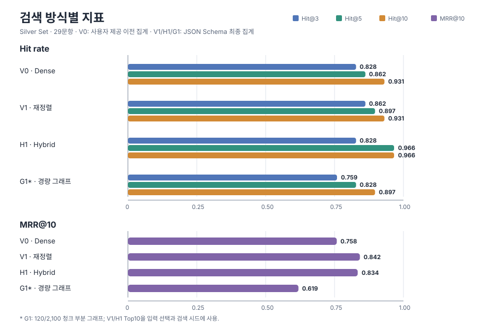

<!--
책임: RAG 검색 방식 비교 실험의 공개 가능한 결과와 해석을 기록한다.
구현할 기능: Dense, 재정렬, Hybrid, Ollama 경량 GraphRAG의 집계 지표와 평가 범위를 설명한다.
완료 기준: 비공개 질문 추적·코퍼스·원시 로그를 포함하지 않고, 지표별 출처를 구분한다.
-->

# 검색 실험 집계 결과와 한계

비교 설계와 요약 해석은 [실험 보고서](EXPERIMENT_REPORT.md), 결과 기록 기준은 [실험 보고 기준](../../../docs/EXPERIMENT_REPORTING.md)을 참고하세요.

## 요약

29문항 Silver Set에서 H1은 Hit@5/10이 가장 높았고, V1은 Hit@3과 MRR@10이 가장 높았다. 제한된 G1 파일럿은 V1/H1의 기존 Top10을 그래프 청크 선택과 검색 시드에 사용했으며, 별도의 전체 코퍼스 비교는 아니다. 현재 근거로는 H1의 활용 가능성을 추가 평가하고 G1 확대 적용은 보류한다.

## 실험 목적과 조건

Dense 검색(V0), 재정렬 검색(V1), Hybrid 검색(H1), Ollama 기반 경량 GraphRAG(G1)의 근거 검색 결과를 비교했다. Microsoft GraphRAG Local/Global은 별도 래퍼이며 여기의 Ollama G1 결과에 포함하지 않는다.

| 항목 | 조건 |
|---|---|
| 문서 범위 | 5종 문서군 |
| 평가 질문 | Silver Set 29문항 |
| 공통 검색 기반 | V0/V1/H1은 동일 청크·임베딩 조건에서 비교 |
| V0 | Dense 검색 순위 |
| V1 | Dense 후보를 재정렬 |
| H1 | Dense와 BM25 순위를 RRF(k=60)로 결합 |
| G1 | 전체 2,100개 중 120개 청크에 그래프를 구축한 로컬 파일럿 |
| G1 입력과 검색 시드 | 기존 V1/H1 Top10을 그래프 청크 선택 및 그래프 검색 시드에 사용 |
| 최종 G1 기록 | JSON Schema 적용 후 실패 청크만 재추출. V1/H1 기록은 재사용하고 G1 검색 기록만 갱신 |

G1은 부분 그래프를 사용하고 기존 검색 결과를 선택·검색 시드에 재사용했다. 따라서 G1을 V0/V1/H1과 같은 독립적이고 동일 범위의 비교군으로 해석하지 않는다.

## 정량 결과

Hit@k는 해당 순위 안에서 정답 근거 청크를 하나 이상 찾은 질문의 비율이다. 아래 값은 29문항 기준이다.

| 방식 | Hit@3 | Hit@5 | Hit@10 | MRR@10 | nDCG@10 | 지표 출처 |
|---|---:|---:|---:|---:|---:|---|
| Dense (V0) | 0.828 (82.8%) | 0.862 (86.2%) | 0.931 (93.1%) | 0.758 | 0.799 | 사용자가 제공한 이전 비교 집계 |
| 재정렬 (V1) | 0.862 (86.2%) | 0.897 (89.7%) | 0.931 (93.1%) | 0.842 | 집계 없음 | JSON Schema 최종 집계 |
| Hybrid (H1) | 0.828 (82.8%) | 0.966 (96.6%) | 0.966 (96.6%) | 0.834 | 집계 없음 | JSON Schema 최종 집계 |
| 경량 GraphRAG (G1, JSON Schema 최종 실행) | 0.759 (75.9%) | 0.828 (82.8%) | 0.897 (89.7%) | 0.619 | 집계 없음 | JSON Schema 최종 집계 |

V0 수치는 이전 비교 집계에서 사용자가 제공한 값이다. 확인 가능한 최종 G1 집계 보고서에는 V0가 포함되지 않아 출처를 별도로 표시했다. V1/H1/G1 수치는 JSON Schema 최종 집계에 기록되어 있으며, 그 실행에서 V1/H1 검색 기록은 재사용됐다. nDCG@10은 V0의 제공값만 확인된다. V1/H1/G1의 nDCG@10은 확인 가능한 집계에 없으며, Hit·Recall·MRR만으로 복원하지 않았다.

### G1 구버전과 JSON Schema 최종 실행

| G1 실행 | Hit@3 | Hit@5 | Hit@10 | MRR@10 |
|---|---:|---:|---:|---:|
| 이전 format=json 실행 | 0.276 | 0.517 | 0.966 | 0.300 |
| JSON Schema 최종 실행 | 0.759 | 0.828 | 0.897 | 0.619 |

두 기록 사이 Hit@3/5와 MRR@10은 높아졌고 Hit@10은 낮아졌다. 변경 원인은 확인되지 않았다. 이 차이를 JSON Schema 자체의 효과로 해석하지 않는다.

## 대표 질문별 검색·답변 추적 요약

아래 표는 비공개 원본 추적에서 확인한 첫 정답 근거 순위만 요약한다. 질문 원문, 청크 ID·본문, 출처 필드, 실제 모델 참고자료, 최종 답변과 인용은 공개하지 않는다.

| 사례 | 질문 ID | V1 / H1 / G1 첫 정답 순위 | 확인된 차이 |
|---|---|---:|---|
| H1 순위 개선 | P03 | 6 / 5 / 6 | H1이 V1보다 한 순위 앞섰다. G1에서는 별도로 검색 결과 밖 인용 ID가 1건 확인됐다. |
| V1 순위 우세 | A03 | 2 / 4 / 1 | V1이 H1보다 앞섰고, 이 사례의 G1 정답 근거는 1위였다. |
| G1 추가 근거 한계 | P08 | 없음 / 5 / 없음 | H1은 정답 근거를 찾았지만 V1과 G1은 Top10에서 찾지 못했다. |
| G1 인용 연결 실패 사례 | P04 | 1 / 1 / 3 | 세 방식 모두 정답을 검색했다. G1 인용 ID 1건이 해당 G1 검색 결과에 없어 자동 연결 검증에 실패했다. 이는 답변 내용의 사실 오류 판정이 아니다. |

선택 사례의 검색 결과 밖 인용은 P03과 P04의 G1 응답에서 각각 1건씩 확인됐다. 나머지 사례·방식 조합에서는 이 검증 실패가 없었다. 이 검사는 인용 ID가 해당 검색 결과 집합에 존재하는지만 확인한다.

### 검색 청크와 실제 전달 자료의 차이

검색된 전체 청크(chunk_text_full)와 모델 참고자료 payload에 실제 포함된 텍스트(reference_text_sent)는 서로 다를 수 있다. G1은 context_for의 길이 제한에 따라 참고자료를 잘라 전달할 수 있다. 아래 숫자는 각 사례의 G1 검색 청크 중 전달 텍스트가 잘린 청크 수다.

| 질문 ID | G1 검색 청크 수 | 잘린 전달 텍스트 |
|---|---:|---:|
| P03 | 9 | 3 |
| P04 | 10 | 2 |
| P08 | 10 | 1 |
| A03 | 10 | 0 |

따라서 검색 청크 본문 전체를 실제 모델 입력과 같은 것으로 간주하지 않는다. 비공개 부록은 전체 검색 청크와 실제 전달 payload를 별도 절로 보존한다.

### 답변·인용 검증 범위

집계 코드의 answer_errors는 answer.get('error')가 있는 응답만 센다. 집계의 0/29는 응답·생성 오류가 없었다는 뜻이며, 답변 내용이 사실에 맞거나 인용 근거와 의미상 일치했다는 판정이 아니다. 질문별 사실성 및 근거의 의미상 일치는 검토하지 않았으므로 판단 불가로 둔다. 인용 ID의 검색 결과 포함 여부는 별도 구조 검증이며, 위 선택 사례에서 P03과 P04의 G1 인용 연결 실패가 각각 1건 있었다.

## 분석과 한계

- **H1의 근거 회수:** V1보다 Hit@5는 89.7%에서 96.6%로, Hit@10은 93.1%에서 96.6%로 높았다. 반면 Hit@3은 낮고 MRR@10도 V1의 0.842보다 낮다. 중간 순위까지 근거를 더 자주 회수했지만, 가장 높은 순위에서 더 정확했다고 결론 내릴 수는 없다.
- **V1의 상위 순위:** Hit@3 86.2%와 MRR@10 0.842로 V1/H1 중 가장 높았다. 초반 순위가 중요한 조건에서는 V1이 우세했다.
- **G1의 검색 이득:** G1의 Hit@10은 89.7%, MRR@10은 0.619였다. 최종 집계 보고서는 V1/H1 Top10 합집합 밖의 새 정답 청크를 0건 추가했다고 기록한다. JSON Schema 적용 후 이전 G1에서 얻던 정답 청크 쌍 2건은 사라졌다. 차이의 원인은 확인되지 않았으며, 부분 그래프 파일럿만으로 전체 GraphRAG의 성능을 판단하지 않는다.
- **G1 추출 범위:** 전체 2,100개 중 120개 청크를 대상으로 했다. 최초 추출은 120개 중 57개 성공·63개 실패였고, 실패 63개를 재시도해 61개 성공·2개 실패가 남았다. 최종 성공은 118/120개(98.3%)다.

| 추출 단계 | 대상 | 성공 | 실패 |
|---|---:|---:|---:|
| 최초 추출 | 120 | 57 | 63 |
| JSON Schema 재시도 | 63 | 61 | 2 |
| 최종 그래프 | 120 | 118 | 2 |

- **검증 한계:** 대표 추적은 검색 순위, 전체 검색 청크, 실제 전달 payload, 답변과 인용을 연결해 보관한다. 다만 전체 system/API 메시지는 기록되지 않았고, 답변의 의미상 사실성과 근거 일치는 평가하지 않았다. 추적에 페이지·구간·URL이 없으면 별도로 보완하지 않았다.
- **재현 범위:** 최종 집계는 전체 검색 실험을 새로 수행한 결과가 아니다. V1/H1 기록을 재사용하고 G1 기록을 갱신했다. 원본 질문 추적과 평가 파일은 공개하지 않아 공개 저장소만으로 독립 재계산할 수 없다.

## 최종 결정

- **H1:** 상위 5~10개 근거 회수에서 활용 가능성을 확인했다. 운영 기본값으로 채택하기 전 별도 평가로 다시 확인한다.
- **G1:** 확대 적용을 보류한다. 부분 그래프 범위, 낮은 MRR@10, 기존 V1/H1 Top10 밖의 추가 정답 부재, 남은 추출 실패 2건을 고려하면 현재 근거만으로 적용 범위를 넓히기 어렵다.
- **답변 품질:** 응답 오류 카운트와 인용 ID 구조 검증만 확인했다. 답변 사실성과 근거의 의미상 일치는 판정하지 않았다.

## 공개 범위와 출처

| 자료 | 공개 문서에 포함 | 판정 |
|---|---|---|
| 집계 지표와 방법별 한계 | 포함 | 출처가 확인된 수치만 기록하고 V0 사용자 제공값을 구분 |
| 대표 사례의 질문 ID와 첫 정답 순위 | 요약 포함 | 검색 차이를 설명하는 데 필요한 범위로 제한 |
| 질문 원문·검색 청크 ID/본문·실제 모델 payload·답변·인용 | 미포함 | Git에서 제외되는 로컬 비공개 부록에 보관 |
| 페이지·구간·URL | 미포함 | 원본 추적에 기록되지 않아 추가하거나 추정하지 않음 |
| 코퍼스, 질문 추적, 원시 모델 로그 | 미포함 | 공개 대상에서 제외 |

선택 사례의 검색 자료는 FinanceBench 관련 문서와 AMI 주석에 걸쳐 있다. FinanceBench 데이터셋 페이지는 CC BY-NC 4.0을 표시하므로 재배포에는 저작자 표시와 비상업 조건이 적용된다. 일부 검색 근거가 된 SEC EDGAR 공시는 재사용 가능하다고 SEC가 안내하지만, 이는 FinanceBench 질문 데이터의 라이선스 조건을 바꾸지 않는다. [FinanceBench 라이선스 표기](https://huggingface.co/datasets/PatronusAI/financebench), [SEC 재사용 안내](https://www.sec.gov/about/webmaster-frequently-asked-questions), [CC BY-NC 4.0 조건](https://creativecommons.org/licenses/by-nc/4.0/deed.en)

AMI 주석은 공식 페이지에서 CC BY 4.0으로 안내한다. 다만 CC 라이선스가 제3자의 개인정보·초상·인격권까지 허가하지는 않으므로 회의 전사나 발췌문은 해당 권리와 공개 목적을 따로 확인해야 한다. [AMI 라이선스](https://groups.inf.ed.ac.uk/ami/corpus/license.shtml), [CC 라이선스와 제3자 권리](https://creativecommons.org/faq/)

질문 원문, 원본 청크, 모델 전달 자료와 답변은 로컬 비공개 부록 rag/experiments/results/RESULTS_PRIVATE_APPENDIX_20261110.md에만 보관하며 Git ignore 대상이다. 이 문서에는 이 자료의 내용을 복사하지 않았다.
